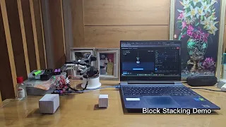

# E.V.A. — Electromechanical Versatile Arm

> A 3D-printed, six-servo robotic arm that moves **one motor at a time**, with a web dashboard, a live 3D digital twin,
> teach-and-replay, automatic pick-and-place and a small library of gestures.


<!-- TODO: add a demo GIF or a YouTube link here, e.g.  [](https://youtu.be/...) -->

E.V.A. is a hobby robot arm built around an **Arduino Uno** and a **PCA9685** servo driver. It started as "make every servo move"
and grew into a small robotics stack: a calibrated firmware, an inverse-kinematics engine, a browser dashboard with a 3D twin
of the arm, and a safety checker that refuses motions that would drive the gripper into the table.

The most important design decision came from a failure: after a power-supply accident burned an Arduino and a PCA9685,
every motion in E.V.A. is serialised so that **only one servo moves at any moment**
(see [what went wrong](docs/08-what-went-wrong.md)).

## Highlights

- **One motor at a time.** The firmware scheduler moves a single joint, pauses, then moves the next. Peak current stays low.
- **Calibrated joints.** Per-joint pulse range, direction, home angle, limits, speed and acceleration, with a documented
  [calibration procedure](docs/03-calibration-guide.md).
- **Smooth motion.** Speed- and acceleration-limited ramps, a speed cap, and a guard that keeps every servo off its end stops.
- **Inverse kinematics.** `XYZ` targets for the wrist; fingertip-based targets for pick-and-place.
- **Web dashboard** ([`software/eva_control.py`](software/eva_control.py)): joint sliders, XYZ moves, **3D digital twin** with a
  fingertip trail, **teach & replay**, bulk **pose import** with a feasibility report, **pick & place** with a reachable-zone map,
  and a **gesture library** (wave, nod, shake, bow, point, handshake).
- **Safety checker.** Before anything plays, poses are checked against joint limits, the table, the base, and the
  *in-between* positions the one-at-a-time motion passes through.
- **Tested.** 28 Python tests and 16 firmware-simulation checks run in CI.

## Specifications

| | |
|---|---|
| Axes | 6 servos: base, shoulder, elbow, wrist roll, wrist pitch, gripper (5 arm joints + gripper) |
| Servos | 3 × MG996R (base, shoulder, elbow), 3 × MG90S (roll, pitch, gripper) |
| Controller | Arduino Uno + PCA9685 16-channel PWM driver (I²C address 0x40) |
| Power | 2 × 3.7 V Li-ion in series → 5 V buck converter (3 A rated) → servo rail; the Arduino is powered over USB |
| Links | base height 9.7 cm, upper arm 12.0 cm, forearm 9.3 cm, gripper 11.8–15.2 cm beyond the forearm |
| Control | USB serial at 115200 baud, [simple text protocol](docs/serial-protocol.md) |
| Software | Python 3 (Flask, pyserial) + three.js in the browser |

## Quick start

> Read the [safety notes](docs/06-safety.md) first. Always power the arm up while it rests in the home pose.

1. **Build** the arm and wire it as in [`hardware/schematics`](hardware/schematics/README.md) and the [build guide](docs/01-build-guide.md).
2. **Flash** [`firmware/EVA_firmware`](firmware/EVA_firmware/EVA_firmware.ino) with the Arduino IDE
   (library: *Adafruit PWM Servo Driver Library*).
3. **Calibrate** your servos and edit the joint table in the sketch ([guide](docs/03-calibration-guide.md)).
   The table in this repository is the calibration of *my* arm, so yours will differ.
4. **Run the dashboard:**
   ```bash
   pip install -r software/requirements.txt
   python software/eva_control.py COM3        # or /dev/ttyUSB0; the port is auto-detected if you leave it out
   ```
   then open <http://localhost:5000>. Close the Arduino Serial Monitor first: only one program can use the port.
5. Start at a **low speed**, try the sliders, then the [demos](docs/demo-guide.md).

## Repository layout

| Folder | What is in it |
|---|---|
| [`firmware/`](firmware/) | The Arduino sketch and how to build and flash it |
| [`software/`](software/) | The Python dashboard and its requirements |
| [`hardware/`](hardware/) | Schematic, bill of materials, measured dimensions, CAD / print files |
| [`docs/`](docs/) | Build, wiring, calibration, software and kinematics guides; the build story; what went wrong; roadmap |
| [`poses/`](poses/) | Example pose sequences you can import (for example the wave) |
| [`media/`](media/) | Photos, GIFs and video thumbnails for the README |
| [`tests/`](tests/) | Python tests and the firmware simulation |

## Documentation

| Guide | |
|---|---|
| [01 Build guide](docs/01-build-guide.md) | From parts to a moving arm |
| [02 Wiring and power](docs/02-wiring-and-power.md) | Schematic, power budget, protection |
| [03 Calibration guide](docs/03-calibration-guide.md) | Make "30°" really mean 30° |
| [04 Software guide](docs/04-software-guide.md) | Using the dashboard |
| [05 Kinematics](docs/05-kinematics.md) | Conventions, the maths, the safety model |
| [06 Safety](docs/06-safety.md) | Hazards and checklists |
| [07 How I built it](docs/07-how-i-built-it.md) | The build story |
| [08 What went wrong](docs/08-what-went-wrong.md) | Failures, causes and fixes |
| [09 Roadmap and improvements](docs/09-roadmap-and-improvements.md) | What I would do next |
| [10 Troubleshooting](docs/10-troubleshooting.md) | Symptom → cause → fix |
| [Serial protocol](docs/serial-protocol.md) | Talking to the firmware directly |
| [Demo guide](docs/demo-guide.md) | Recording a good demo |

## Status

E.V.A. works and is used for demos, but it is a hobby project with an open-loop servo setup: there is no position feedback and
no current sensing. Known limitations and the plan are in the [roadmap](docs/09-roadmap-and-improvements.md).

## Name

**E.V.A.** stands for **E**lectromechanical **V**ersatile **A**rm. (Change this line if you prefer another meaning.)

## License and credits

Released under the [MIT License](LICENSE). Some of the code and documentation were written with AI assistance
(Claude, by Anthropic); all of it was tested on the real arm or in the included simulations. <!-- delete this line if you prefer -->
