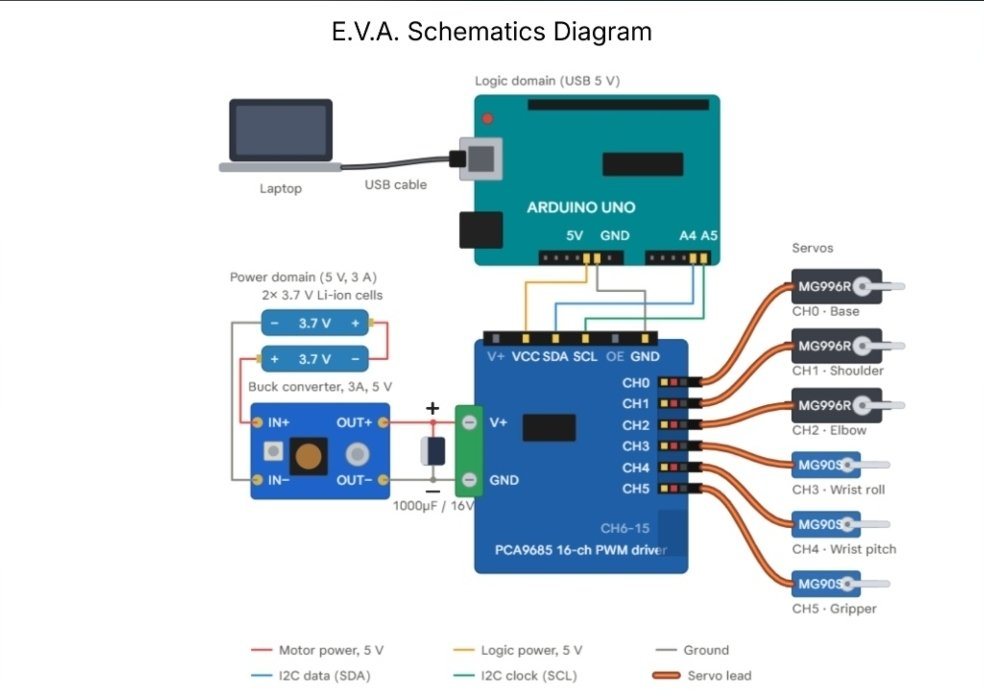

# 02 · Wiring and power

## Two power domains

| Domain | Source | Feeds |
|---|---|---|
| **Logic (USB 5 V)** | The laptop's USB port | Arduino Uno and, through its 5 V pin, the PCA9685 logic (VCC) |
| **Servo power (5 V)** | 2 × 3.7 V Li-ion cells in series → 5 V buck converter | The PCA9685 `V+` screw terminal, which feeds all six servos |

The two domains share **ground** through the PCA9685 board (its header GND and the screw-terminal GND are the same net). Never connect the
servo 5 V rail to the Arduino 5 V pin.

## Connections

| From | To |
|---|---|
| Cell pack − (top cell −) | Buck converter `IN−` |
| Top cell + | Bottom cell − (series link) |
| Bottom cell + | Buck converter `IN+` (through the toggle switch) |
| Buck `OUT+` | PCA9685 terminal `V+` |
| Buck `OUT−` | PCA9685 terminal `GND` |
| 1000 µF / 16 V capacitor | across the terminal `V+` (+) and `GND` (−): stripe on the negative leg |
| Arduino 5V | PCA9685 `VCC` |
| Arduino GND | PCA9685 `GND` (header) |
| Arduino A4 | PCA9685 `SDA` |
| Arduino A5 | PCA9685 `SCL` |
| Servo on PCA9685 channel 0 | Base (MG996R) |
| Channel 1 | Shoulder (MG996R) |
| Channel 2 | Elbow (MG996R) |
| Channel 3 | Wrist roll (MG90S) |
| Channel 4 | Wrist pitch (MG90S) |
| Channel 5 | Gripper (MG90S) |

Servo plugs: brown/black (ground) towards the edge of the board, red in the middle, orange/yellow (signal) towards the inside.
Leave the PCA9685 `V+` header pin and the `OE` pin unconnected.

## Power budget (why one motor at a time)

Approximate figures; check your servos' datasheets.

| Item | Typical | Worst case |
|---|---|---|
| MG996R, idle | a few tens of mA | — |
| MG996R, moving under load | 0.5–1 A | about 2.5 A when stalled (datasheet figure at 6 V) |
| MG90S, moving | 0.1–0.3 A | roughly 0.7 A when stalled |
| Three MG996R together | 1.5–3 A | 7 A or more |
| Buck converter rating | 3 A | usually a peak, not a continuous rating |

Three large servos moving together can exceed a 3 A converter even on a normal move, and a converter that hits its limit sags or
spikes. That is what the one-at-a-time scheduler avoids: only one servo accelerates at a time, the others just hold their position.
Holding still still costs current (the shoulder and elbow carry the arm's weight), so a long stretched-out pose is the worst case:
test it ([build guide](01-build-guide.md#9-first-move-checklist)).

## Protection worth adding

The current build has the capacitor and the one-at-a-time firmware. The following cost very little and are strongly recommended
(they are also on the [roadmap](09-roadmap-and-improvements.md)):

- **A fuse** (or resettable polyfuse) on the battery + line, sized just above the buck converter's rating.
- **A TVS diode** (for example SMBJ5.0A) across the servo rail at the PCA9685 terminal, to absorb voltage spikes from the motors.
- **A larger, low-ESR capacitor** (2200–4700 µF) right at the terminal, with insulated leads and firmly mounted (a loose capacitor can short).
- **A 2S Li-ion protection board (BMS)** with over-discharge and short-circuit protection. Two bare cells in series have no protection of their own.
- **A converter with real headroom**: a 5 V UBEC or buck rated 5 A or more continuous, and cells that can deliver that current.
- **The toggle switch** in the battery line (the real build has one; the diagram does not show it).

## Power-up and power-down rules

1. Arm resting at home, speed slider low.
2. USB first (Arduino and PCA9685 logic), then the servo switch.
3. Power down in the opposite order.
4. **Never plug or unplug servo, signal or I²C wires while the servo power is on**: hot-plugging is a classic way to kill a PCA9685 channel.
5. If you power-cycle only the PCA9685 and not the Arduino, the PCA9685 forgets its 50 Hz setting. Press the Arduino reset button.

## Checks with a multimeter before the first power-up

- [ ] Battery pack voltage is correct (7.4 V nominal, 6.0–8.4 V) and the polarity into `IN+` / `IN−` is right.
- [ ] Buck output is 5.0–5.3 V with **no servos attached** (set it with its trim pot).
- [ ] No continuity between servo `V+` and the Arduino 5 V pin.
- [ ] The capacitor stripe is on the ground side, and its legs cannot touch anything.
- [ ] Continuity: Arduino GND ↔ PCA9685 GND ↔ buck `OUT−`.
