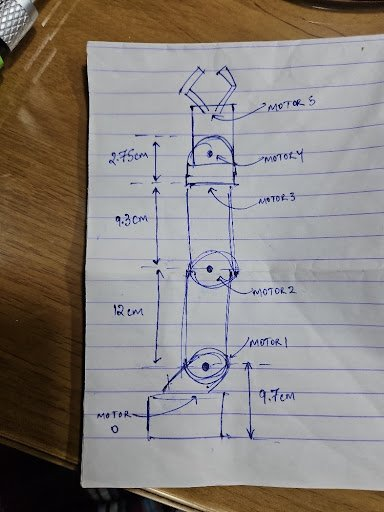
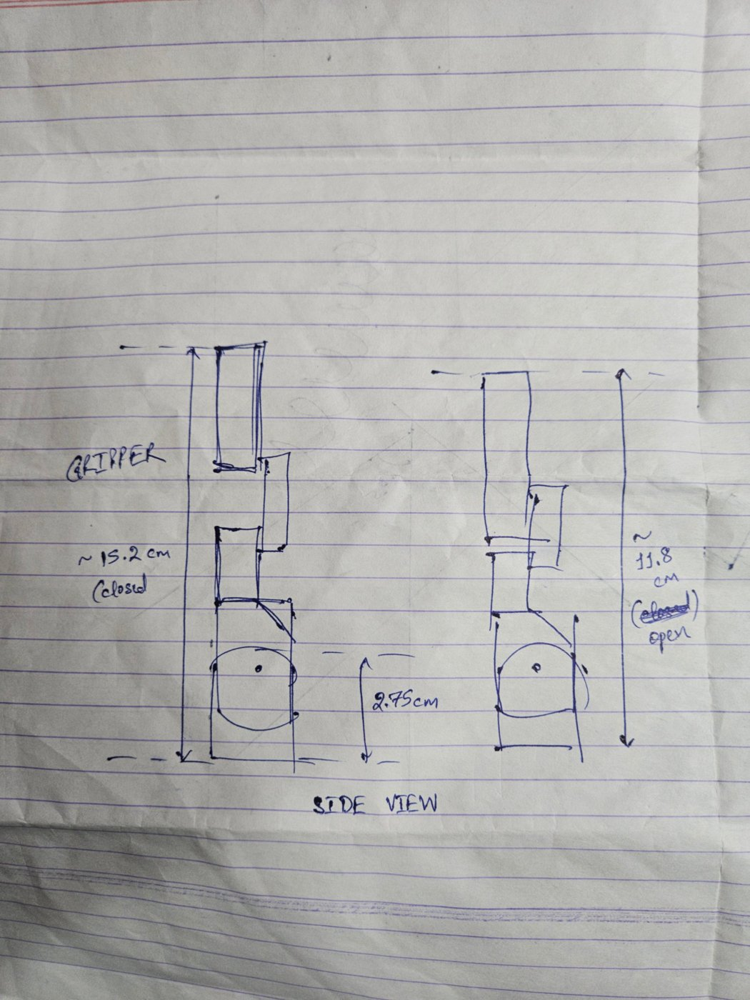

# Dimensions

Measured on the real arm. All lengths in centimetres.

| Symbol | Value | What it is |
|---|---|---|
| `H0` | 9.7 | Table to the shoulder pivot |
| `L1` | 12.0 | Shoulder pivot to elbow pivot (upper arm) |
| `L2` | 9.3 | Elbow pivot to the end of the forearm (the wrist pivot is assumed here) |
| wrist block | 2.75 | Height of the roll / pitch block above the forearm |
| gripper, closed | 15.2 | Forearm top to the fingertips with the fingers closed |
| gripper, open | 11.8 | The same with the fingers fully open (the tips swing outwards, so the length shrinks) |
| `L3` (derived) | 4.8 | Forearm top to the finger pivots |
| `GRIP` (derived) | 10.4 | Finger length, assuming at most 48° of opening |

`L3` and `GRIP` are *derived* from the two gripper lengths and the 48° assumption, not measured directly; see [kinematics](../../docs/05-kinematics.md#the-gripper-model).
In the gripper sketch the words "closed" and "open" were corrected by hand, so re-measure before relying on them.

## Sketches

| | |
|---|---|
|  | Link lengths and joint positions (motor 0 is the base, motor 5 is the gripper) |
|  | Gripper side view, closed (left) and open (right) |

## How to measure

- Measure joint-axis to joint-axis (screw centre to screw centre), not outside edges.
- Put the arm in the home pose (straight up) to measure the vertical dimensions.
- Measure the gripper from the **top of the forearm** to the fingertips, closed and open.
- Measure the offset from the top of the forearm to the centre of the wrist-pitch screw and add it to `L2` in the firmware and `CONFIG` ([roadmap item](../../docs/09-roadmap-and-improvements.md)).
