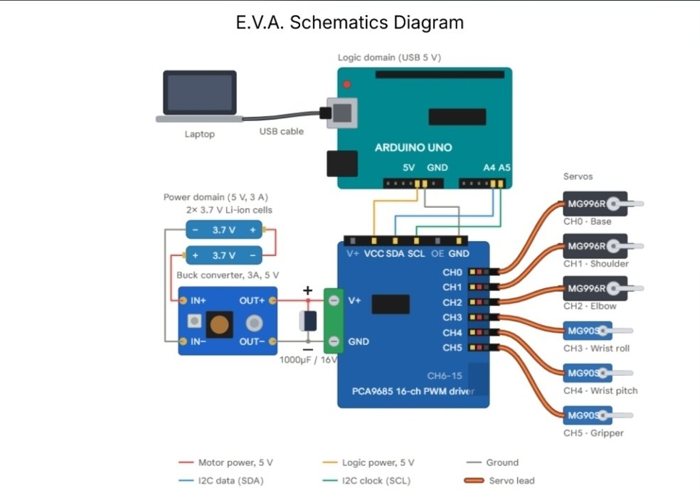

# Schematic

`eva-schematic.jpg` is the wiring diagram of E.V.A. Explanation and the full connection table: [docs/02-wiring-and-power.md](../../docs/02-wiring-and-power.md).

## Review of the diagram

Checked against the build and the firmware:

| Item | Verdict |
|---|---|
| Two Li-ion cells in series: top cell − → buck `IN−`, top + → bottom −, bottom + → `IN+` | Correct (7.4 V nominal) |
| Buck `OUT+` → PCA9685 `V+`, `OUT−` → `GND` | Correct |
| 1000 µF / 16 V capacitor across `V+` / `GND`, polarity marked | Correct; the rating is fine for 5 V |
| Arduino 5V → `VCC`, GND → `GND`, A4 → `SDA`, A5 → `SCL` | Correct |
| Servos on channels 0–5: base, shoulder, elbow (MG996R), roll, pitch, gripper (MG90S) | Matches the joint table in the firmware |
| `V+` header pin and `OE` left unconnected | Correct |
| Logic (USB) and servo domains separate | Correct; the shared ground is through the PCA9685 board |

## Things to add to the diagram

1. **The toggle switch** in the battery line. The real build has one.
2. **A fuse** between the cell pack and the converter, and a **TVS diode** across the servo rail ([why](../../docs/02-wiring-and-power.md#protection-worth-adding)).
3. **A cell-protection board (BMS)** for the 2S pack.
4. A note that **ground is common** through the PCA9685 (its header GND and terminal GND are the same net).
5. The **converter rating** as "3 A (peak)" rather than "3 A", and the cell type.

## Redrawing it

The image is a raster diagram. For a version people can edit and review, redraw it in [KiCad](https://www.kicad.org/) (schematic) or Fritzing and commit the source files here next to the image.
